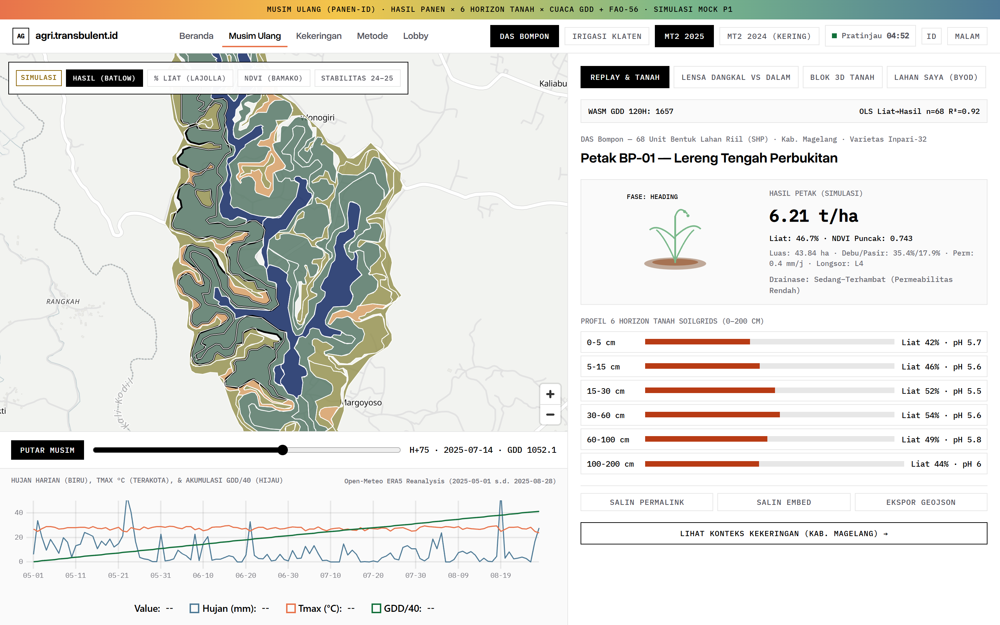
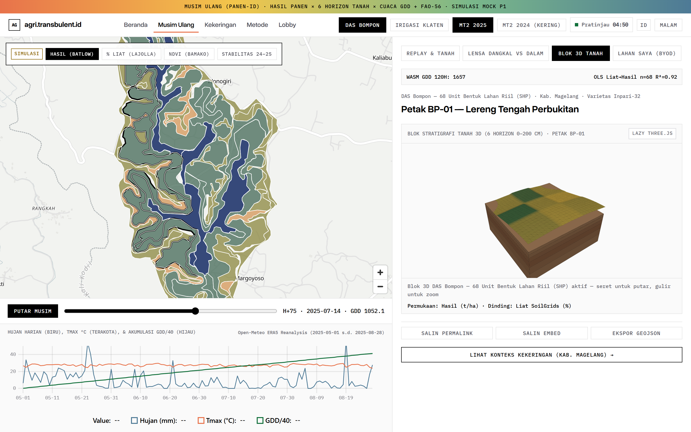
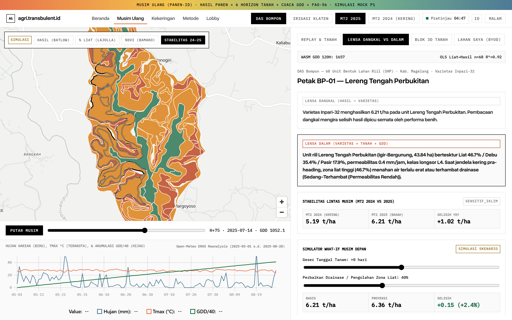
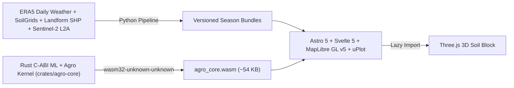

<div align="center">

# Panen-ID — Season Replay & Precision Agronomy Observatory

**Open-source geospatial Season Replay platform explaining *where, when, and why* crop yields diverge—combining plot yield, 6-horizon SoilGrids stratigraphy, real Open-Meteo ERA5 weather, Rust WebAssembly (`agro-core`), and lazy Three.js 3D soil blocks.**

**Observatorium *Musim Ulang (Season Replay)* open-source untuk menjelaskan *di mana, kapan, dan karena apa* hasil panen berbeda—memadukan peta petak/lahan, 6 horizon tanah, cuaca riil ERA5, kernel Rust WebAssembly (`agro-core`), serta blok tanah 3D Three.js (*lazy-load*).**

[](https://agri.transbulent.id/ulang/bompon-magelang/mt2-2025/)
[](./crates/agro-core/)
[](./web/)
[](https://agri.transbulent.id/ulang/lahan-saya)
[](./CITATION.cff)

[English](#-english) · [Bahasa Indonesia](#-bahasa-indonesia) · [Live Season Replay](https://agri.transbulent.id/ulang/bompon-magelang/mt2-2025/) · [BYOD Workspace](https://agri.transbulent.id/ulang/lahan-saya) · [Citation](#-citation--sitasi)

</div>

---

<p align="center">
  
</p>

<table>
  <tr>
    <td width="50%" align="center">
      
      <br />
      <sub><strong>3D Soil Stratigraphy / Blok Tanah 3D</strong> — Lazy-loaded Three.js with 6 SoilGrids horizons (0–200 cm)</sub>
    </td>
    <td width="50%" align="center">
      
      <br />
      <sub><strong>Stability &amp; What-If / Stabilitas 24–25</strong> — Multi-season YoY comparison &amp; management simulator</sub>
    </td>
  </tr>
</table>

---

## 🇬🇧 English

### Why Panen-ID?

Most harvest maps stop at a *shallow read*—ranking hybrids or averaging yields per block. **Panen-ID** layers harvest outcomes onto physical soil attributes, elevation/landform morphology, and daily weather aligned by Growing Degree Days (`GDD`), answering the agronomic core question:

> *"Where did this cultivar underperform, when in its phenology, and why?"*

### Key Capabilities

- **68 Real Geomorphic Landform Units (`DAS Bompon`)**: Real watershed landform polygons preserving measured clay/silt/sand fractions, permeability (`mm/hr`), landslide susceptibility classes, and SoilGrids 6-horizon depth profiles (`0–200 cm`), paired with irrigated lowland comparison (`Klaten`).
- **Pure-Rust WebAssembly ML & 5-Crop Phenology (`crates/agro-core`)**: Zero-dependency C-ABI Rust compiled to WebAssembly (`~54 KB`) running in-browser modified **GDD** & **phenology stages across 5 Indonesian crops** (*Padi*, *Jagung*, *Kedelai*, *Bawang Merah*, *Tebu*), **FAO-56 Penman-Monteith $ET_0$**, **IDW interpolation**, quantile-seeded **K-Means 3 management zones (`Zona AI`)** with Silhouette score, and **4×4 Ridge Explainable AI** (global feature importance + per-plot yield attribution with `n < 30` statistical guard).
- **Multi-Season Stability (`MT2 2024` vs `MT2 2025`) & What-If Simulator**: Uses real archived **Open-Meteo ERA5** daily weather (`120` days per season) to compare a dry season (`2024`, `590.4 mm`) against a wetter season (`2025`, `1,065.8 mm`), classify units (`stabil_tinggi`, `sensitif_iklim`, `rentan_kronis`), and test planting-date shifts or clay-zone drainage improvements.
- **Lazy 3D Stratigraphic Block (`Three.js`)**: Dynamically imports `three.js` only when opening the 3D tab, keeping initial bundle size lightweight while visualizing surface yield relief atop 6 subsurface horizons.
- **Local-First BYOD + Indonesia ERA5 Weather Diagnostics (`/lahan-saya`)**: Analyze private `.csv` or `.geojson` farm plots anywhere across Indonesia (`95°–141° E, 6° N–11° S`) directly inside browser memory, fetch KV-cached archipelago Open-Meteo ERA5 series (`/api/v1/weather`), and compute client-side WASM `GDD`, phenology, and FAO-56 water balance—plus compact D1 shortlink sharing (`/s/[slug]`).
- **Reproducible Earth Observation Pipeline (`pipeline/`)**: Sentinel-2 L2A reflectance processing explicitly handling Processing Baseline >= 04.00 radiometric offset (`BOA_ADD_OFFSET = -1000`), SCL cloud masking, gap interpolation, and smooth NDVI curves.
- **Cross-Pillar Climate Context**: Direct jump links into regional soil-landscape drought indices ([`drought-in-control`](https://github.com/gisrad/drought-in-control)) at [`/kekeringan/`](https://agri.transbulent.id/kekeringan/).

### Technical Architecture



### Quickstart & Verification

```bash
# 1. Run Rust WASM unit tests
cargo test --manifest-path crates/agro-core/Cargo.toml

# 2. Build & preview the web workbench
cd web
npm install
npm run dev      # http://127.0.0.1:4327
npm run build    # Static bundle in web/dist/

# 3. Run Sentinel-2 pipeline unit tests & offline dry-run (stdlib only)
cd ..
python -m unittest discover -s pipeline -p "test_*.py" -v
python pipeline/season_bake.py --dry-run
```

---

## 🇮🇩 Bahasa Indonesia

### Mengapa Panen-ID?

Peta panen biasa umumnya berhenti pada *pembacaan dangkal* (menyalahkan benih atau sekadar membandingkan rata-rata varietas). **Panen-ID** melapiskan hasil petak di atas **tekstur tanah aktual, satuan bentuk lahan, dan cuaca harian berbasis Growing Degree Days (`GDD`)** untuk menjawab:

> *"Varietas ini kurang hasil di mana, pada fase tanam kapan, dan karena faktor lingkungan apa?"*

### Fitur Utama

- **68 Unit Bentuk Lahan Riil DAS Bompon & Irigasi Klaten**: Poligon geomorfologi riil lengkap dengan kadar Liat/Debu/Pasir terukur, permeabilitas tanah, kelas rawan longsor, dan profil 6 horizon SoilGrids (`0–200 cm`).
- **Mesin ML & Fenologi Rust WebAssembly (`crates/agro-core`)**: Biner WASM ringkas (`~54 KB`) di sisi klien untuk fenologi **5 komoditas Indonesia** (*Padi*, *Jagung*, *Kedelai*, *Bawang Merah*, *Tebu*), **FAO-56 $\text{ET}_0$**, **interpolasi IDW**, klasterisasi **`Zona AI (K-Means)`** 3 zona manajemen, serta **Explainable AI Regresi Ridge $4 \times 4$** (*Feature Importance* global + atribusi hasil per petak lengkap dengan guard `n < 30` sampel).
- **Peta Stabilitas Lintas Musim (`MT2 2024` vs `MT2 2025`) & Simulator What-If**: Membandingkan musim kemarau riil ERA5 `2024` (`590,4 mm`) melawan musim basah `2025` (`1.065,8 mm`) guna memetakan petak stabil vs rentan kronis serta menguji skenario geser tanggal tanam dan perbaikan drainase zona liat berat.
- **Blok Stratigrafi Tanah 3D (`Three.js` Lazy)**: Memvisualisasikan relief hasil panen di atas dinding 6 lapisan tanah secara interaktif tanpa membebani muatan awal halaman.
- **Ruang Kerja Privat *Local-First* + Cuaca ERA5 Nusantara (`/lahan-saya`)**: Unggah CSV/GeoJSON dari seluruh wilayah Indonesia (`95°–141° BT, 6° LU–11° LS`), tarik deret cuaca harian Open-Meteo ERA5 (`/api/v1/weather`), dan hitung neraca air FAO-56 + GDD langsung di WASM peramban, serta berbagi via tautan singkat D1 (`/s/[slug]`).
- **Pipeline Sentinel-2 L2A (`pipeline/`)**: Menangani koreksi offset radiometrik Baseline >= 04.00 (`BOA_ADD_OFFSET = -1000`), masking awan SCL, dan interpolasi kurva NDVI.

### Keamanan & Provenans Data

- **Tanpa Rahasia di Repositori**: Kredensial penyimpanan atau API hanya dibaca melalui environment variables saat runtime.
- **Penanda Provenans Eksplisit**: Angka hasil panen sintetis dan skenario *What-If* selalu diberi label `SIMULASI` baik di layar maupun pada metadata ekspor `.csv` dan `.geojson` siap QGIS.

---

## Documentation / Dokumentasi

| Document | Scope |
| --- | --- |
| [`docs/ARCHITECTURE.md`](./docs/ARCHITECTURE.md) | Web stack, Rust C-ABI WASM kernel, lazy 3D block & BYOD local-first workspace |
| [`docs/SCIENCE_AND_DATA.md`](./docs/SCIENCE_AND_DATA.md) | GDD, FAO-56 Penman-Monteith, Sentinel-2 Baseline >= 04.00 & soil stratification |
| [`docs/ADR_GEOLIBRE_SPIKE.md`](./docs/ADR_GEOLIBRE_SPIKE.md) | Architectural evaluation of Rust map cores vs MapLibre GL + Rust compute WASM |
| [`docs/ROADMAP.md`](./docs/ROADMAP.md) | Completed stages & multi-commodity Indonesian expansion plan |
| [`CHANGELOG.md`](./CHANGELOG.md) | Release notes |

## 📜 Citation / Sitasi

See [`CITATION.cff`](./CITATION.cff) or cite in **APA 7th Edition**:

> Transbulent Research Group. (2026). *Panen-ID (Musim Ulang / Season Replay): Precision Agronomy & Soil-Weather Observatory* (Version 0.8.0) [Computer software]. https://github.com/gisrad/panen-id

```bibtex
@software{transbulent_panen_id_2026,
  author       = {{Transbulent Research Group}},
  title        = {{Panen-ID (Musim Ulang / Season Replay): Precision Agronomy & Soil-Weather Observatory}},
  year         = {2026},
  version      = {0.8.0},
  url          = {https://agri.transbulent.id/ulang/bompon-magelang/mt2-2025/},
  repository   = {https://github.com/gisrad/panen-id},
  license      = {MIT}
}
```
